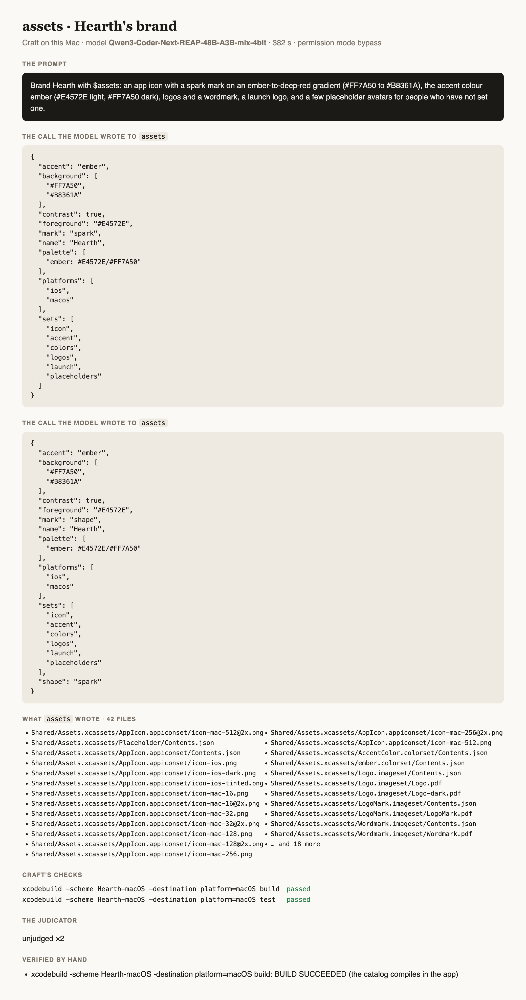
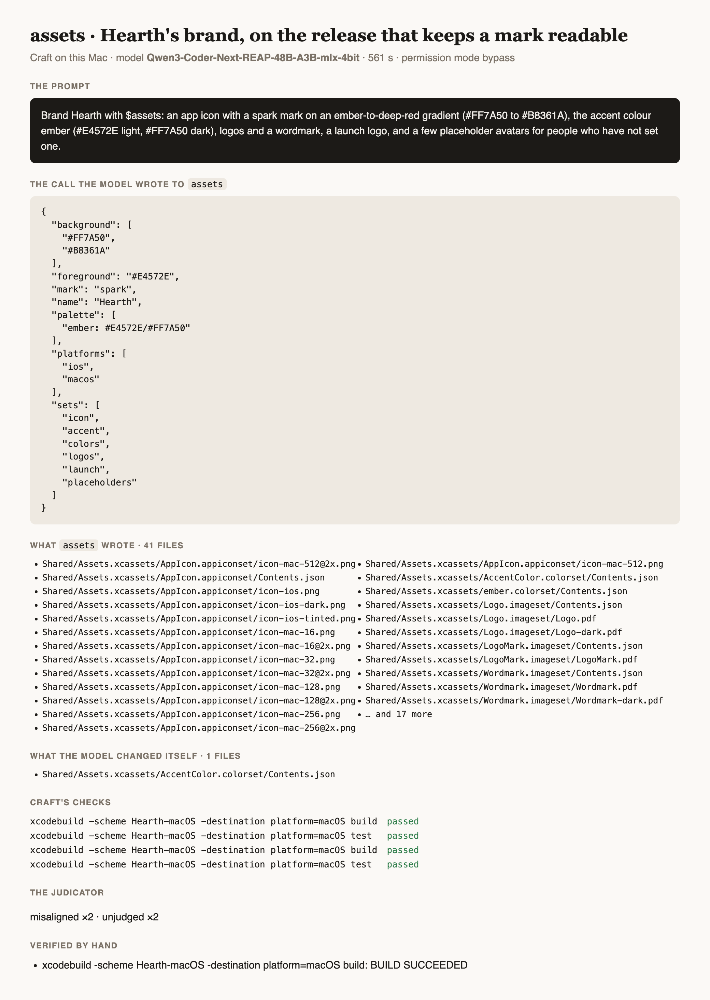
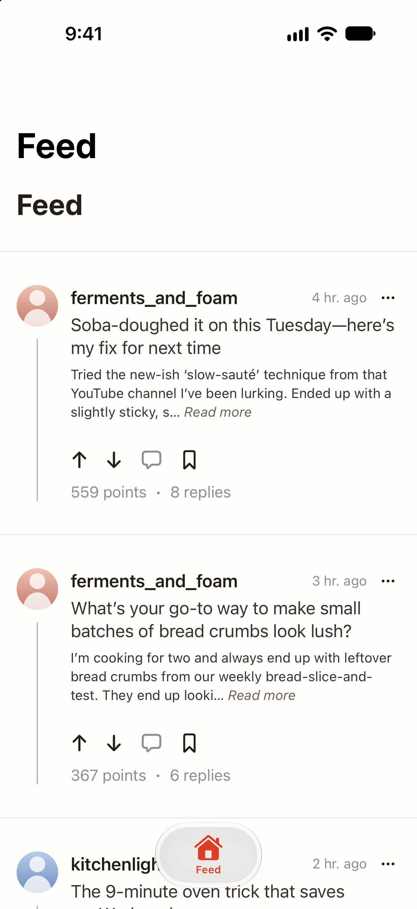

# Testing AssetsAgent

How `assets` is tested: its own suite, its gated build of real output, and prompts run through
[Craft](https://github.com/riteshpakala/Craft) on a Mac with Craft's own local model, each logged below verbatim with
what came out. A prompt is run as a person would type it, in a project folder, with `$` naming the agent; nothing is
edited between the prompt and the screenshots. A test that needs a server uses mock backend responses, never a live
service.

## The suite

```
swift test                                  # the record, the schema, the lines, the files, a call through the roster
ASSETS_BUILD=1 swift test --filter AssetsBuildTests   # the output built for real (gated, minutes)
```

## Prompts run on this Mac

Setup: MacBook Pro M4 Max (128 GB), macOS 27, Xcode 27.1, Craft built from `main`, the model Craft loads
(`rao-studios/Qwen3-Coder-Next-REAP-48B-A3B-mlx-4bit`), permission mode bypass, the agent installed from this repository
with `craft agents add`.

### 1. Hearth's brand: a spark icon on an ember gradient, in a Granite app (the journey's third prompt)

*2026-11-01 · Qwen3-Coder-Next-REAP-48B-A3B-mlx-4bit · 382 s*

**The prompt**, verbatim:

```text
Brand Hearth with $assets: an app icon with a spark mark on an ember-to-deep-red gradient (#FF7A50 to #B8361A), the accent colour ember (#E4572E light, #FF7A50 dark), logos and a wordmark, a launch logo, and a few placeholder avatars for people who have not set one.
```

**The call the model wrote** to `assets`:

```json
{
  "accent": "ember",
  "background": [
    "#FF7A50",
    "#B8361A"
  ],
  "contrast": true,
  "foreground": "#E4572E",
  "mark": "spark",
  "name": "Hearth",
  "palette": [
    "ember: #E4572E/#FF7A50"
  ],
  "platforms": [
    "ios",
    "macos"
  ],
  "sets": [
    "icon",
    "accent",
    "colors",
    "logos",
    "launch",
    "placeholders"
  ]
}
```

**The call the model wrote** to `assets`:

```json
{
  "accent": "ember",
  "background": [
    "#FF7A50",
    "#B8361A"
  ],
  "contrast": true,
  "foreground": "#E4572E",
  "mark": "shape",
  "name": "Hearth",
  "palette": [
    "ember: #E4572E/#FF7A50"
  ],
  "platforms": [
    "ios",
    "macos"
  ],
  "sets": [
    "icon",
    "accent",
    "colors",
    "logos",
    "launch",
    "placeholders"
  ],
  "shape": "spark"
}
```

**What `assets` wrote** (42 files): `Shared/Assets.xcassets/AppIcon.appiconset/icon-mac-512@2x.png`, `Shared/Assets.xcassets/Placeholder/Contents.json`, `Shared/Assets.xcassets/AppIcon.appiconset/Contents.json`, `Shared/Assets.xcassets/AppIcon.appiconset/icon-ios.png`, `Shared/Assets.xcassets/AppIcon.appiconset/icon-ios-dark.png`, `Shared/Assets.xcassets/AppIcon.appiconset/icon-ios-tinted.png`, `Shared/Assets.xcassets/AppIcon.appiconset/icon-mac-16.png`, `Shared/Assets.xcassets/AppIcon.appiconset/icon-mac-16@2x.png`, `Shared/Assets.xcassets/AppIcon.appiconset/icon-mac-32.png`, `Shared/Assets.xcassets/AppIcon.appiconset/icon-mac-32@2x.png`, `Shared/Assets.xcassets/AppIcon.appiconset/icon-mac-128.png`, `Shared/Assets.xcassets/AppIcon.appiconset/icon-mac-128@2x.png`, `Shared/Assets.xcassets/AppIcon.appiconset/icon-mac-256.png`, `Shared/Assets.xcassets/AppIcon.appiconset/icon-mac-256@2x.png`, `Shared/Assets.xcassets/AppIcon.appiconset/icon-mac-512.png`, `Shared/Assets.xcassets/AccentColor.colorset/Contents.json`, `Shared/Assets.xcassets/ember.colorset/Contents.json`, `Shared/Assets.xcassets/Logo.imageset/Contents.json`, `Shared/Assets.xcassets/Logo.imageset/Logo.pdf`, `Shared/Assets.xcassets/Logo.imageset/Logo-dark.pdf`, `Shared/Assets.xcassets/LogoMark.imageset/Contents.json`, `Shared/Assets.xcassets/LogoMark.imageset/LogoMark.pdf`, `Shared/Assets.xcassets/Wordmark.imageset/Contents.json`, `Shared/Assets.xcassets/Wordmark.imageset/Wordmark.pdf`, `Shared/Assets.xcassets/Wordmark.imageset/Wordmark-dark.pdf`, `Shared/Assets.xcassets/Lockup.imageset/Contents.json`, `Shared/Assets.xcassets/Lockup.imageset/Lockup.pdf`, `Shared/Assets.xcassets/Lockup.imageset/Lockup-dark.pdf`, `Shared/Assets.xcassets/LaunchLogo.imageset/Contents.json`, `Shared/Assets.xcassets/LaunchLogo.imageset/LaunchLogo.pdf` …

**Craft's checks**: `xcodebuild -scheme Hearth-macOS -destination platform=macOS build` passed; `xcodebuild -scheme Hearth-macOS -destination platform=macOS test` passed

**The judicator**: unjudged ×2

**Verified by hand**:
- `xcodebuild -scheme Hearth-macOS -destination platform=macOS build`: BUILD SUCCEEDED, the catalog compiled into the app; Craft's own build and test checks by the scheme passed


*What the call drew: the iOS icon, the macOS icon on Apple's grid, and the iOS dark icon. The model passed the accent as the mark's colour, so the light icons put an ember spark on an ember ground*


*The same call through the release after this run: a mark colour under 3:1 on its ground is set aside for white or ink, and the answer says so*


*The outcome card*

**Notes**:
- The model's first call said `mark: spark` (a shape's name where the kind of mark goes) and was refused with a decoding error; its second call (`mark: shape, shape: spark`) worked. The release after this run reads a shape's own name in `mark` as that shape.
- The model passed `foreground: #E4572E`, the accent, which shows at 1.0:1 on the ember ground; the agent drew it as asked. The release after this run keeps a 3:1 floor for any mark colour, given or not (WCAG 1.4.11), and names the colour it set aside.
- The judicator returned no verdict (unjudged): the call wrote images only.

### 2. The same prompt, on the release that keeps a mark readable (8719713)

*2026-11-01 · Qwen3-Coder-Next-REAP-48B-A3B-mlx-4bit · 561 s*

**The prompt**, verbatim:

```text
Brand Hearth with $assets: an app icon with a spark mark on an ember-to-deep-red gradient (#FF7A50 to #B8361A), the accent colour ember (#E4572E light, #FF7A50 dark), logos and a wordmark, a launch logo, and a few placeholder avatars for people who have not set one.
```

**The call the model wrote** to `assets`:

```json
{
  "background": [
    "#FF7A50",
    "#B8361A"
  ],
  "foreground": "#E4572E",
  "mark": "spark",
  "name": "Hearth",
  "palette": [
    "ember: #E4572E/#FF7A50"
  ],
  "platforms": [
    "ios",
    "macos"
  ],
  "sets": [
    "icon",
    "accent",
    "colors",
    "logos",
    "launch",
    "placeholders"
  ]
}
```

**What `assets` wrote** (41 files): `Shared/Assets.xcassets/AppIcon.appiconset/icon-mac-512@2x.png`, `Shared/Assets.xcassets/AppIcon.appiconset/Contents.json`, `Shared/Assets.xcassets/AppIcon.appiconset/icon-ios.png`, `Shared/Assets.xcassets/AppIcon.appiconset/icon-ios-dark.png`, `Shared/Assets.xcassets/AppIcon.appiconset/icon-ios-tinted.png`, `Shared/Assets.xcassets/AppIcon.appiconset/icon-mac-16.png`, `Shared/Assets.xcassets/AppIcon.appiconset/icon-mac-16@2x.png`, `Shared/Assets.xcassets/AppIcon.appiconset/icon-mac-32.png`, `Shared/Assets.xcassets/AppIcon.appiconset/icon-mac-32@2x.png`, `Shared/Assets.xcassets/AppIcon.appiconset/icon-mac-128.png`, `Shared/Assets.xcassets/AppIcon.appiconset/icon-mac-128@2x.png`, `Shared/Assets.xcassets/AppIcon.appiconset/icon-mac-256.png`, `Shared/Assets.xcassets/AppIcon.appiconset/icon-mac-256@2x.png`, `Shared/Assets.xcassets/AppIcon.appiconset/icon-mac-512.png`, `Shared/Assets.xcassets/AccentColor.colorset/Contents.json`, `Shared/Assets.xcassets/ember.colorset/Contents.json`, `Shared/Assets.xcassets/Logo.imageset/Contents.json`, `Shared/Assets.xcassets/Logo.imageset/Logo.pdf`, `Shared/Assets.xcassets/Logo.imageset/Logo-dark.pdf`, `Shared/Assets.xcassets/LogoMark.imageset/Contents.json`, `Shared/Assets.xcassets/LogoMark.imageset/LogoMark.pdf`, `Shared/Assets.xcassets/Wordmark.imageset/Contents.json`, `Shared/Assets.xcassets/Wordmark.imageset/Wordmark.pdf`, `Shared/Assets.xcassets/Wordmark.imageset/Wordmark-dark.pdf`, `Shared/Assets.xcassets/Lockup.imageset/Contents.json`, `Shared/Assets.xcassets/Lockup.imageset/Lockup.pdf`, `Shared/Assets.xcassets/Lockup.imageset/Lockup-dark.pdf`, `Shared/Assets.xcassets/LaunchLogo.imageset/Contents.json`, `Shared/Assets.xcassets/LaunchLogo.imageset/LaunchLogo.pdf`, `Shared/Assets.xcassets/LaunchLogo.imageset/LaunchLogo-dark.pdf` …

**What the model changed itself**: `Shared/Assets.xcassets/AccentColor.colorset/Contents.json`

**Craft's checks**: `xcodebuild -scheme Hearth-macOS -destination platform=macOS build` passed; `xcodebuild -scheme Hearth-macOS -destination platform=macOS test` passed; `xcodebuild -scheme Hearth-macOS -destination platform=macOS build` passed; `xcodebuild -scheme Hearth-macOS -destination platform=macOS test` passed

**The judicator**: misaligned ×2, unjudged ×2

**Verified by hand**:
- `xcodebuild -scheme Hearth-macOS -destination platform=macOS build`: BUILD SUCCEEDED


*Hearth's icons after one call: white sparks on the ember ground, and the coral spark on the dark one*


*The outcome card*

**Notes**:
- The model wrote the same two things as in run 1, `mark: spark` and `foreground: #E4572E`, and this time one call did it: the shape's name read as the shape, and the mark colour under 3:1 set aside for white.
- Craft's judicator caught a real gap: the prompt asked for the accent ember #E4572E, and the agent derived #DF5D33 because the model named the palette line `ember`, not `accent`; the model then edited AccentColor by hand. The release after this run makes the first palette line the app's AccentColor exactly as given when no line is named accent, and says so.

## Conformance on Hearth

Level 1 of the regime: the call a model should write, sent straight to the installed runner over its wire
(granite-agent/1) with no model, on a copy of Hearth as the journey left it (services, mock data and loom's views
made), then checked by building, testing and screenshotting the app. A pass here means the agent can produce the
result deterministically; whether Craft's model writes this call is tested by the prompts above.

### A kit's colours added to Hearth's catalog

*2026-11-01 · straight to the runner, no model*

**The call**:

```json
{
  "name": "Hearth",
  "palette": [
    "colors/background: #FFFDF9/#141110",
    "colors/alternateBackground: #F8F2EC/#1B1714",
    "colors/secondaryBackground: #F3ECE4/#211C18",
    "colors/tertiaryBackground: #EBE2D8/#2A231E",
    "colors/foreground: #231C17/#F5EEE7",
    "colors/secondaryForeground: #6E6259/#ADA197"
  ]
}
```

**Checks**:
- First run refused: `colors/background` was not a colour name. Fixed: `group/name` is a set in a namespace folder
- Second run redrew the icon and made the page colour the tint, so the tab item went white. Fixed: a later call writes only what its lines give and keeps an existing AccentColor
- Third run: only Shared/Assets.xcassets/colors/ written; icon and AccentColor kept


*Loom's views on the colours assets wrote, the ember tab kept*
